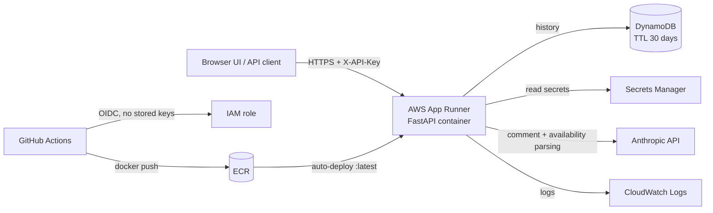

# Expert Profile API

A small FastAPI service that turns raw career text and screening questions (VQs) into a formatted,
email-ready expert profile. It parses semi-structured career data, normalises locations to countries,
converts interview availability from any time zone to Korea Standard Time (daylight-saving aware), and
uses an LLM (Anthropic Claude) to draft a short career comment. It runs locally, in Docker, or on AWS.

> **All data in this repository is synthetic.** Names, companies and career histories in
> `app/sample_data.py` are invented. No real personal or client data is stored or used.

## Architecture



| Concern | Choice |
|---|---|
| Compute | AWS App Runner (container from ECR, auto-deploy on new image) |
| Database | DynamoDB on-demand, items expire automatically via TTL |
| Secrets | AWS Secrets Manager (injected as environment variables) |
| CI/CD | GitHub Actions: pytest, then docker build + push to ECR |
| Auth to AWS | GitHub OIDC federation (short-lived credentials, no access keys in GitHub) |
| Observability | JSON logs to CloudWatch, `/health` endpoint used by App Runner health checks |
| IAM | Separate least-privilege roles for image pull, the running service, and CI |

## API

| Method | Path | Auth | Description |
|---|---|---|---|
| GET | `/health` | none | status, whether an LLM key and DynamoDB are configured |
| GET | `/api/sample` | none | synthetic demo requests |
| POST | `/api/profile` | `X-API-Key` | build a profile (see `app/models.py` for the request schema) |
| GET | `/api/profiles` | `X-API-Key` | recent history (without the HTML body) |
| GET | `/` | none | single-page web UI |

Interactive docs: `/docs` (Swagger UI).

## Key design points

* **LLM understands, code calculates.** The model only interprets free-text availability and returns
  IANA time zone keys; all date/time arithmetic uses `zoneinfo`, so daylight-saving shifts are always correct.
* **Graceful degradation.** Without an LLM key, or if the API call fails, the service still returns a
  complete profile using a template comment and an ISO-format availability parser. Nothing crashes.
* **Defensive parsing.** Unrecognised career text yields a warning, not an error; duplicate lines are removed;
  a current job at the target company is found even if it is not the first entry.
* **Simple authentication.** A shared secret in the `X-API-Key` header, compared in constant time.
  The server refuses to run unauthenticated unless `AUTH_DISABLED=true` is set explicitly (dev only).
* **Tested.** 18 pytest tests cover parsing, DST conversion, current-role selection, auth, and the HTTP API.

## Run locally

```bash
python3 -m venv .venv && source .venv/bin/activate
pip install -r requirements-dev.txt
pytest -q

export APP_API_KEY=dev-key             # required (clients send it as X-API-Key)
# export ANTHROPIC_API_KEY=sk-ant-...  # optional; without it the template mode is used
uvicorn app.main:app --reload
# open http://localhost:8000, paste dev-key in "API key", click "Sample 1", then "Generate profile"
```

Or with Docker:

```bash
docker build -t expert-profile-api .
docker run --rm -p 8000:8000 -e APP_API_KEY=dev-key expert-profile-api
```

## Deploy to AWS

Step-by-step instructions are in [`GUIDE_KR.md`](GUIDE_KR.md) (Korean). In short:

```bash
export GITHUB_REPO="<user>/expert-profile-api"
bash infra/setup.sh            # DynamoDB, ECR, Secrets Manager, IAM roles, GitHub OIDC
git push origin main           # Actions: test -> build -> push image to ECR
bash infra/create-service.sh   # App Runner service (auto-deploys on every new image)
bash infra/teardown.sh         # remove everything when finished
```

## Limitations and next steps

* History uses a DynamoDB `Scan`; a larger deployment would add a GSI on `created_at`.
* Add rate limiting / AWS WAF in front of the public endpoint, and per-user keys instead of one shared key.
* Infrastructure is scripted with the AWS CLI; porting it to Terraform or CDK would make it declarative.
* Output is HTML for pasting into email clients; a `.docx` export could be added.
